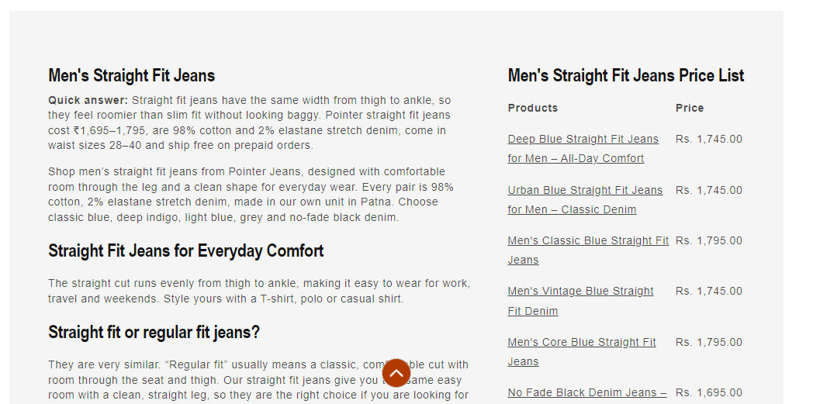

# Dynamic Footer Details

*Pointer Jeans — custom section, built February 2026*

## What it is
A two-column collection footer that shows the collection's description
alongside a **price list table** of every product in that collection —
each product name links directly to its product page, with its price
shown alongside. Only renders when the collection has a description set.

## Key features
- **Left column:** collection title + description (auto-converts the
  description's `<h1>` to `<h2>` to keep heading hierarchy correct).
- **Right column:** a table listing every product in the collection —
  product name (linked) and price — generated dynamically from
  `collection.products`, with a configurable empty-state message when a
  collection has no products.
- Configurable column headings ("Products" / "Price") and title
  visibility via the theme editor.
- Responsive: 65/35 two-column grid on desktop, stacks to a single
  column on mobile with adjusted font sizing.

## Tech
Shopify Liquid (section + schema), CSS Grid

## Setup
Add `collection-footer.liquid` to the theme's `sections/` folder — it
registers as "Collection footer" in the theme editor's section picker.
Add it to the collection template; it only renders if the collection has
a description.

## Files
- [`collection-footer.liquid`](./collection-footer.liquid) — full section code