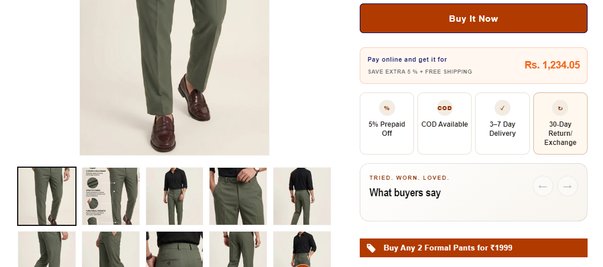

# Offer Block (Redirect to In-Offer Product Page)

*Pointer Jeans — custom snippet, built June 2026*

## What it is
A product-page snippet that displays a grid of **combo/bundle offers**
(e.g. "Buy Any 2 Jeans for ₹2999"), each linking directly to the
relevant offer collection page. Added via a custom liquid block rather
than a full section.

## Key features
- Grid of offer cards, each with an icon + offer text, fully linked to
  its target collection/offer page.
- Reusable snippet — easy to duplicate/edit offer text and links for
  different campaigns or products.
- Styled via a dedicated CSS file kept separate from the markup.

## Tech
Shopify Liquid (snippet), inline SVG icons, CSS

## Setup
1. Add `custom-offer-block.css` to the theme's `assets/` folder.
2. On the product page, inside the Product information section, add a
   **Custom Liquid** block and paste in the contents of
   `offer-block.liquid`.
3. Update the offer text and `/collections/...` links to match the
   active offers/products.

## Files
- [`offer-block.liquid`](./offer-block.liquid) — snippet code
- [`custom-offer-block.css`](./custom-offer-block.css) — markup code
