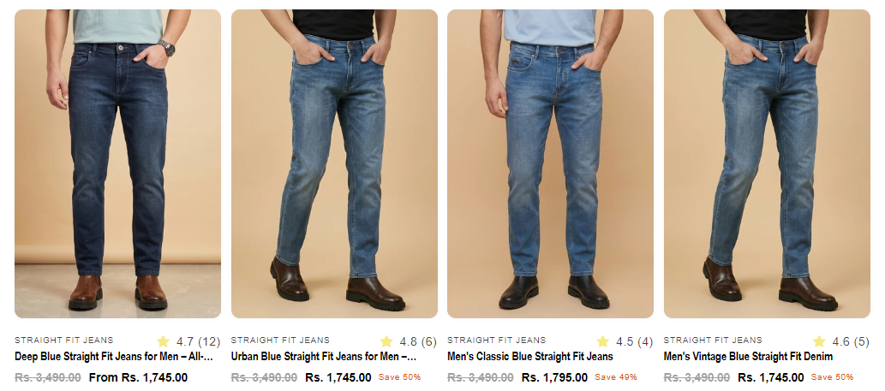
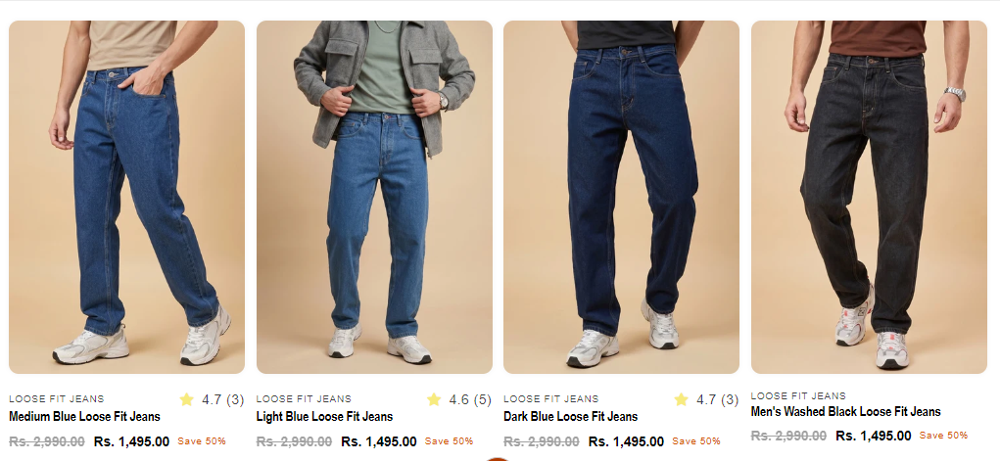

# Product Card Dynamic Text

*Pointer Jeans — custom feature, built June 2026*

## What it is
A customization added inside Dawn's existing `card-product.liquid` file
to show the **collection name above the product title** on each product
card (collection page), alongside the existing Judge.me star rating
badge — both fit into one row without overlapping or overflowing.

## How it works
- Pulls the collection name from a product metafield
  (`metafields.custom.main_collection_name`) rather than hardcoding it,
  so it's dynamic per product.
- A flex layout keeps the collection name (left, truncated with
  ellipsis if too long) and the Judge.me rating badge (right, fixed
  width) aligned on the same row regardless of text length.
- Text is clamped to a single line with `-webkit-line-clamp` to prevent
  card layout from breaking on long collection names.

## Tech
Shopify Liquid (metafields, existing theme file customization), CSS
(flexbox, line-clamp truncation)

## Setup
1. Add the CSS from the `<style>` block to `component-rating.css`.
2. Add the HTML/Liquid markup inside the `card__information` div in
   `card-product.liquid`.
3. Requires a `custom.main_collection_name` metafield set per product.

## Files
- [`card-product-sub-heading.liquid`](./card-product-sub-heading.liquid) — the code (style + markup)